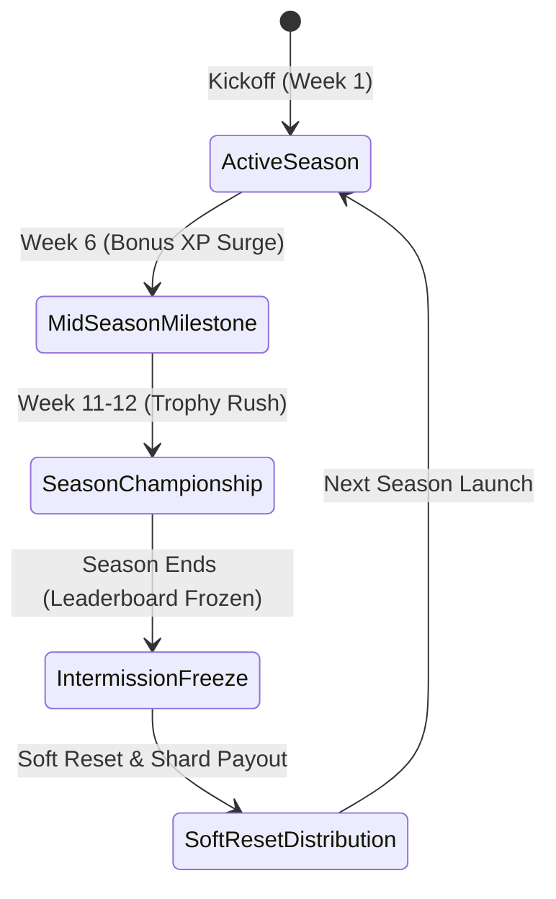
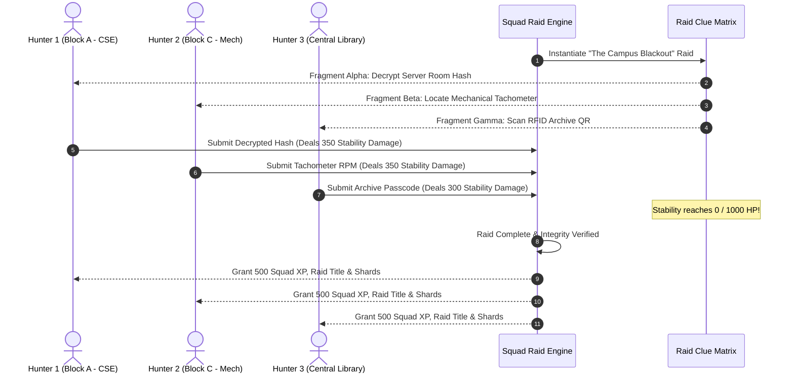
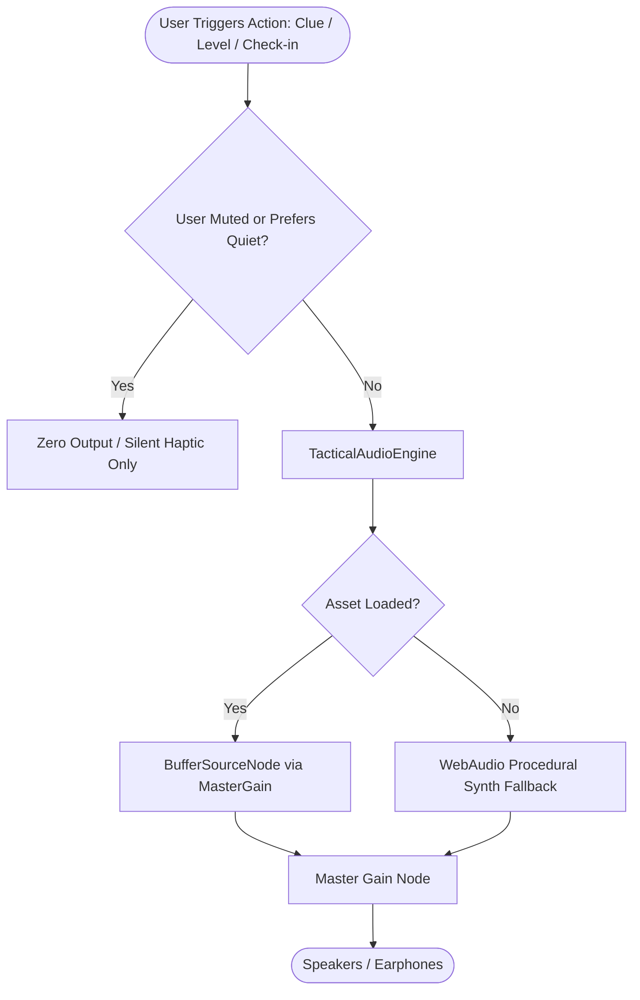
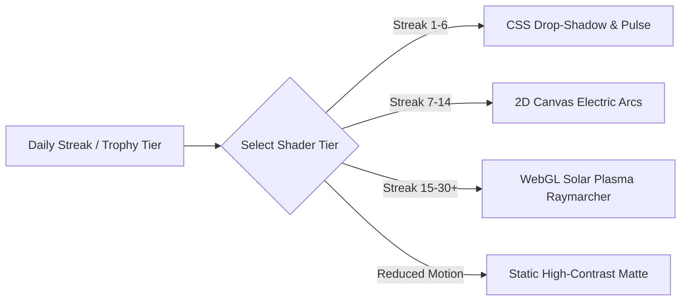

# AIEM Hunt — Game Design & Feature Ideation Roadmap
**Document Version:** 1.0.0  
**Effective Target:** 2026 – 2027 Academic Cycles  
**Status:** Living Design Specification & Architecture Blueprint  
**Target Platform:** AIEM Hunt (Next.js 15, React 19, Tailwind CSS, MongoDB/Mongoose, Framer Motion, Web Audio & WebGL)

---

## Executive Summary & Core Game Philosophy

AIEM Hunt fuses real-world campus utility (rapid lost-and-found recovery, safe-desk physical custody, fraud-resilient handover workflows) with live-ops alternate reality game (ARG) mechanics. The platform transforms routine campus vigilance into an engaging, collaborative experience.

```
       +--------------------------------------------------------------+
       |                  AIEM HUNT DUAL ENGINE                       |
       +--------------------------------------------------------------+
       |                                                              |
       |   REAL-WORLD UTILITY LAYER           LIVE-OPS GAMIFICATION    |
       |  +-----------------------+          +---------------------+  |
       |  |  Lost & Found Registry|          | Seasonal Leagues    |  |
       |  |  Safe-Desk Verification<-------->| Squad Raid Clues    |  |
       |  |  Physical Handover Pin|          | Prestige Cosmetics  |  |
       |  |  Fraud & Anti-Collusion|         | Kinetic Avatar FX   |  |
       |  +-----------------------+          +---------------------+  |
       |                                                              |
       +--------------------------------------------------------------+
```

### Core Design Pillars
1. **Physical Grounding & Campus Safety First:** Gamification mechanics must incentivize real-world ethical behavior: turning items into Safe Desks, verifying ownership before claim, and respecting campus quiet hours.
2. **Cooperative Camaraderie Over Toxic Competition:** Squad achievements, multi-hunter raid mysteries, and campus-wide milestones promote cross-department collaboration rather than zero-sum griefing.
3. **Tactical "Cyber-Noir" Aesthetic:** Interface design combines high-contrast dark mode, glassmorphism, animated HUD telemetry, tactical military/detective audio cues, and GPU-accelerated particle shaders.
4. **Anti-Inflationary Economic Equilibrium:** Pure vanity sinks, non-linear XP thresholds, and deterministic daily caps prevent hyperinflation and bot-farming.

---

## Table of Contents
1. [Seasonal Prestige Leagues](#1-seasonal-prestige-leagues)
2. [Squad Raid Cosmetics & Collective Achievements](#2-squad-raid-cosmetics--collective-achievements)
3. [Audio & Tactical Sound Effects Engine (SFX)](#3-audio--tactical-sound-effects-engine-sfx)
4. [Animated Avatar Borders & Canvas Particle Effects](#4-animated-avatar-borders--canvas-particle-effects)
5. [Daily Quests & Community Mini-Events](#5-daily-quests--community-mini-events)
6. [Game Economy Balancing & Mathematical Modeling](#6-game-economy-balancing--mathematical-modeling)
7. [Value vs. Effort Prioritization Matrix & Roadmap](#7-value-vs-effort-prioritization-matrix--roadmap)
8. [System Architecture & Data Contracts](#8-system-architecture--data-contracts)

---

## 1. Seasonal Prestige Leagues

### 1.1 Seasonal Cadence & Semester Alignment
AIEM Hunt operates on **12-week Seasonal Cycles** aligned with university academic trimesters:
* **Season Alpha (Fall Semester):** *"The Autumn Reconnaissance"* (Aug – Nov)
* **Season Beta (Spring Semester):** *"The Midnight Protocol"* (Jan – Apr)
* **Season Gamma (Summer Sprint):** *"The Solstice Syndicate"* (May – Jul)

Between seasons, a **1-week Intermission / Calibration Period** enables staff audits, leaderboard freeze verification, and cosmetic distribution.



### 1.2 Soft Reset Mechanics & MMR / Trophy Decay
To prevent leaderboard stagnation while honoring veteran dedication, AIEM Hunt employs a **Compressed Trophy Soft Reset**:

$$\text{Trophies}_{\text{New}} = \text{TrophyFloor} + \lfloor (\text{Trophies}_{\text{Old}} - \text{TrophyFloor}) \times 0.40 \rfloor$$

Where:
* Base Floor = 1,000 Trophies (Bronze/Silver players below 1,000 do not decay).
* Lifetime XP, Level, and Account Cosmetics are **permanent** and never reset.
* Only Seasonal Trophies, Seasonal Leaderboard Rank, and Seasonal Tier decay.

```
+---------------------+-------------------+---------------------+----------------------+
| Current Tier        | Trophy Range      | Post-Reset Floor    | Season Token Payout  |
+---------------------+-------------------+---------------------+----------------------+
| Bronze Scout        | 0 - 999           | 0                   | 50 Prestige Shards   |
| Silver Tracker      | 1,000 - 1,999     | 1,000               | 150 Prestige Shards  |
| Gold Sleuth         | 2,000 - 3,499     | 1,400               | 350 Prestige Shards  |
| Platinum Sentinel   | 3,500 - 4,999     | 2,000               | 700 Prestige Shards  |
| Diamond Vanguard    | 5,000 - 7,499     | 2,600               | 1,200 Prestige Shards|
| Apex Grandmaster    | 7,500+ (Top 100)  | 3,600               | 2,500 Prestige Shards|
+---------------------+-------------------+---------------------+----------------------+
```

### 1.3 Tier Progression & Demotion Protection
* **Promotion Match / Gatekeeper Mystery:** Advancing from Gold to Platinum and Diamond to Apex requires solving a timed, multi-stage "Trial of Vigilance" investigation.
* **Demotion Floor Grace Period:** Once a tier threshold is crossed, a 3-loss or 72-hour grace period prevents immediate demotion from bad luck.

### 1.4 Prestige Cosmetics & Seasonal Badge Tokens
Seasonal Badge Tokens ("Prestige Shards") are exclusive currencies usable in the **Prestige Vault**:
* **Animated Banners:** 
  * *Holo-Grid Apex Horizon* (Continuous CSS scanline beam with ambient starfield particles).
  * *Cipher Terminal 404* (Cascading green matrix glyphs with personal handle watermark).
* **Tier-Specific Dynamic Avatar Badges:**
  * Animated enamel badges that pulse with energy matching the user's highest tier achieved.
* **Prestige Badges (I to X):**
  * Displayed directly beside username on leaderboards, quest boards, and safe-desk manifests.

---

## 2. Squad Raid Cosmetics & Collective Achievements

### 2.1 Cooperative Multi-Hunter Campus Mysteries ("Campus Raid Ops")
Squad Raids are asynchronous, high-difficulty multi-location mysteries spanning physical campus zones. No single hunter can solve a raid alone.



### 2.2 Squad Raid Boss Clues ("The Anomaly Matrix")
* **Mechanic:** A "Raid Boss" clue has a global **Integrity Pool** (e.g., 2,500 HP).
* Each correct sub-clue submission or physical checkpoint check-in chips away at the anomaly's integrity.
* **Time Gate & Overcharge:** Raids run on a 48-hour weekend timer. If solved within 24 hours, all squad members earn an *Encore Star*.

### 2.3 Squad-Wide Cosmetic Unlocks
When a squad accomplishes collective milestones (e.g., 50 Raids Cleared, 200 Items Recovered to Safe Desks), cosmetics unlock for **all squad members**:

| Cosmetic Type | Asset Name | Visual Effect | Unlock Requirement |
|---|---|---|---|
| **Squad Emblem Frame** | *Aegis of the Syndicate* | Gilded obsidian border with animated squad crest wings | Squad Level 10 + 10 Completed Raids |
| **Joint Aura Effect** | *Quantum Tether* | Glowing particle thread linking squadmates when viewed on leaderboards | 5 Squadmates online simultaneously during a Raid |
| **Squad Banner FX** | *Overcharged Plasma* | Violet lightning arcing across the squad header card | Top 5 Squads in Seasonal Trophy Ladder |
| **Tactical Tag Glow** | *Neon Cyan Monogram* | `[TAG]` rendered with 3D drop-shadow and chromatic aberration | 25 Verified Safe-Desk Deposits by Squad |

---

## 3. Audio & Tactical Sound Effects Engine (SFX)

### 3.1 Web Audio API Tactical Architecture
The sound engine relies on a dual-strategy implementation:
1. **Low-Latency Web Audio API Synthesizer:** Generates procedurally crafted sci-fi UI blips, high-tech chimes, and resonant frequencies without needing external audio files.
2. **Preloaded Audio Buffer Pool:** High-fidelity tactile recordings (.mp3/.webm) with volume gain nodes, spatial stereo panning, and automatic gain control (AGC).



### 3.2 Tactical Soundscape Profiles

#### 1. Clue Discovery & Decryption
* **Audio Characteristics:** High-frequency frequency sweep (1200 Hz $\rightarrow$ 3600 Hz) followed by a 4-beat staggered mechanical typewriter decryption stutter.
* **Emotional Valence:** Mystery, intellectual accomplishment, tactical focus.

#### 2. Level-Up Milestone
* **Audio Characteristics:** Resonant sub-bass swell (45 Hz fundamental) building over 600ms, resolving into a shimmering C-Major9 cybernetic synth chord with stereo panning.
* **Emotional Valence:** Grandeur, status enhancement, dopamine reward.

#### 3. Tactical Locker Equipping
* **Audio Characteristics:** Heavy pneumatic servo latch `CLACK`, followed by a magnetic snap (neodymium contact) and a 100ms electric hum.
* **Emotional Valence:** Physicality, tactical readiness, premium feedback.

#### 4. Daily Quest Completion
* **Audio Characteristics:** Crisp metallic coin cascade (5 granular micro-clicks) topped with a sparkling arpeggiated chime.
* **Emotional Valence:** Habitual gratification, economic progress.

#### 5. Safe-Desk Physical Check-in & Handover
* **Audio Characteristics:** Heavy magnetic vault solenoid release sound, physical verification stamp `THUD` (low pass 120Hz), followed by a dual-tone security chime (880 Hz & 1760 Hz).
* **Emotional Valence:** Trust, institutional authority, duty accomplished.

### 3.3 Procedural Audio Synthesizer Specification
```typescript
/**
 * Procedural Web Audio fallback when audio assets are offline or loading.
 */
export class ProceduralTacticalSFX {
  private ctx: AudioContext | null = null;

  private initCtx() {
    if (!this.ctx && typeof window !== "undefined") {
      const AudioCtx = window.AudioContext || (window as any).webkitAudioContext;
      this.ctx = new AudioCtx();
    }
  }

  playRadarPing(freq = 1200, duration = 0.3) {
    this.initCtx();
    if (!this.ctx) return;
    const osc = this.ctx.createOscillator();
    const gain = this.ctx.createGain();

    osc.type = "sine";
    osc.frequency.setValueAtTime(freq, this.ctx.currentTime);
    osc.frequency.exponentialRampToValueAtTime(freq * 2.5, this.ctx.currentTime + duration);

    gain.gain.setValueAtTime(0.2, this.ctx.currentTime);
    gain.gain.exponentialRampToValueAtTime(0.001, this.ctx.currentTime + duration);

    osc.connect(gain);
    gain.connect(this.ctx.destination);
    osc.start();
    osc.stop(this.ctx.currentTime + duration);
  }

  playMechanicalLock() {
    this.initCtx();
    if (!this.ctx) return;
    // Sub-bass thud + white noise burst
    const osc = this.ctx.createOscillator();
    const gain = this.ctx.createGain();
    osc.type = "triangle";
    osc.frequency.setValueAtTime(80, this.ctx.currentTime);
    osc.frequency.exponentialRampToValueAtTime(30, this.ctx.currentTime + 0.15);

    gain.gain.setValueAtTime(0.4, this.ctx.currentTime);
    gain.gain.exponentialRampToValueAtTime(0.01, this.ctx.currentTime + 0.15);

    osc.connect(gain);
    gain.connect(this.ctx.destination);
    osc.start();
    osc.stop(this.ctx.currentTime + 0.15);
  }
}
```

---

## 4. Animated Avatar Borders & Canvas Particle Effects

### 4.1 GPU Acceleration Pipeline
All particle effects and avatar borders adhere to strict performance budgets:
* **Target Framerate:** 60 FPS on mobile devices (iOS Safari, Android Chrome).
* **Battery / Low-Power Mode:** Detects `navigator.hardwareConcurrency <= 4` or `prefers-reduced-motion` and downgrades canvas shaders to static CSS glow effects.
* **Rendering Strategy:** High-efficiency HTML5 `<canvas>` with 2D rendering context or WebGL fragment shaders for top-tier legendary cosmetics.



### 4.2 Streak-Based Dynamic Particle Effects

```
+---------------+---------------------+---------------------------------------------------------+
| Streak Length | Effect Codename     | Visual Description & Particle Specs                     |
+---------------+---------------------+---------------------------------------------------------+
| 3 - 6 Days    | Ember Drifter       | 12-16 floating golden embers rising with 0.8s lifetime  |
| 7 - 14 Days   | Ion Arc Discharge   | Cyan electric sparks arcing across the avatar rim       |
| 15 - 29 Days  | Void Singularity    | Deep violet gravitational distortion with event horizon |
| 30+ Days      | Solar Flare Corona  | Radiant solar prominence plasma flares and gold aura    |
+---------------+---------------------+---------------------------------------------------------+
```

### 4.3 Legendary Titles & CSS Shaders
Titles equipped in the hunter profile unlock responsive typographic shader animations:
* **Apex Grandmaster:** Metallic chrome with 45-degree iridescent sheen sweep:
  ```css
  .title-apex-grandmaster {
    background: linear-gradient(
      120deg,
      #f59e0b 0%,
      #fef08a 25%,
      #f59e0b 50%,
      #b45309 75%,
      #fef08a 100%
    );
    background-size: 200% auto;
    color: transparent;
    -webkit-background-clip: text;
    animation: shineSweep 3s linear infinite;
    text-shadow: 0 0 12px rgba(245, 158, 11, 0.4);
  }
  @keyframes shineSweep {
    to { background-position: 200% center; }
  }
  ```
* **Phantom Custodian:** Chromatic aberration glitch text with micro-jitter transforms.
* **Campus Oracle:** Luminescent emerald pulse with soft backdrop blur.

### 4.4 Reactive Profile 3D Tilt Card
Using Framer Motion and pointer tracking, the Hunter ID card implements a 3D perspective tilt (`rotateX`, `rotateY`, `scale(1.02)`) with a specular foil reflection overlay that shifts dynamically as the user hovers or tilts their device.

---

## 5. Daily Quests & Community Mini-Events

### 5.1 "Rush Hour Recon"
* **Campus Context:** Peak student movement occurs between 08:30 – 09:30 AM (arrival) and 04:30 – 05:30 PM IST (departure).
* **Mechanics:**
  * During these 60-minute windows, active investigations award **+50% XP Boost** and **+20 Bonus Coins**.
  * Drop-zone verification: Checking in at a designated Safe Desk or verified campus kiosk during Rush Hour grants a *Recon Stamp*.
  * 5 Recon Stamps per week award a *Rush Hour Crate*.

```
+--------------------------------------------------------------------------+
|  RUSH HOUR RECON ACTIVE (08:30 - 09:30 IST)                             |
|  [||||||||||||||||||||||||||||||||||||...........] 24m remaining        |
|  * 1.5x XP Multiplier on all Clues                                       |
|  * +20 Coins per Safe-Desk Drop Verification                             |
+--------------------------------------------------------------------------+
```

### 5.2 "Flash Lost Item Alerts" (Emergency Campus Beacons)
* **Trigger Condition:** A high-value or academically critical item is reported lost (e.g., Student ID Card before university examinations, Prescription Inhaler, Laboratory Hard Drive, Scientific Calculator).
* **Alert Broadcast:** An opt-in tactical notification banner appears across the app HUD for seekers in the item's last-known campus sector.
* **Crowdsourced Search Matrix:**
  * The seeker who safely locates and deposits the item at the nearest Safe Desk receives **Double Bounty Reward** and an exclusive *Guardian Angel* badge credit.
  * Verified within 60 minutes: Safe Desk staff triggers an instant campus alert resolution toast.

### 5.3 Weekend Squad Bonuses ("Tactical Syndicate Weekends")
* **Active Window:** Friday 18:00 IST to Sunday 23:59 IST.
* **Squad Boost:** 2x Squad XP contribution multiplier.
* **Campus-Wide Collective Challenge:**
  * Example: *"Campus Recovery Drive: Secure 30 items to Safe Desks across all university departments."*
  * Progress Bar visible on the home dashboard. When the global target is met, **all participants receive 100 Coins and 1 Free Canteen Voucher**.

---

## 6. Game Economy Balancing & Mathematical Modeling

### 6.1 Non-Linear XP Scaling Analysis
AIEM Hunt implements a non-linear exponential-polynomial progression curve defined in `src/lib/progression.ts`:

$$\text{XP}_{\text{step}}(L) = \left\lfloor 150 \cdot L + 50 \cdot L^{1.35} \right\rfloor$$

$$\text{CumulativeXP}(L) = \sum_{i=1}^{L-1} \text{XP}_{\text{step}}(i)$$

#### Empirical Progression Table (Levels 1 to 25)

```
+-------+---------------+------------------+-------------------+----------------------------+
| Level | Step XP Req   | Cumulative XP    | Est. Days (Casual)| Est. Days (Hardcore Sleuth)|
+-------+---------------+------------------+-------------------+----------------------------+
| 1     | 200           | 0                | Day 0             | Day 0                      |
| 2     | 427           | 200              | Day 1             | Day 1                      |
| 3     | 671           | 627              | Day 2             | Day 1                      |
| 4     | 930           | 1,298            | Day 4             | Day 2                      |
| 5     | 1,202         | 2,228            | Day 7             | Day 3                      |
| 6     | 1,485         | 3,430            | Day 11            | Day 5                      |
| 7     | 1,778         | 4,915            | Day 16            | Day 7                      |
| 8     | 2,080         | 6,693            | Day 22            | Day 9                      |
| 9     | 2,391         | 8,773            | Day 29            | Day 12                     |
| 10    | 2,709         | 11,164           | Day 37            | Day 15                     |
| 15    | 4,411         | 29,328           | Day 85            | Day 34                     |
| 20    | 6,289         | 56,470           | Day 155           | Day 62                     |
| 25    | 8,318         | 93,342           | Day 250 (1 Year)  | Day 98 (1 Semester)        |
+-------+---------------+------------------+-------------------+----------------------------+
```

*Casual: ~150 XP/day (1 daily quest + 1 clue).  
Hardcore Sleuth: ~400-500 XP/day (all daily quests, weekend raid, safe-desk deposit, investigation streak).*

### 6.2 Faucet vs. Sink Economic Equilibrium

```
========================= ECONOMIC FAUCET & SINK MODEL =========================

   FAUCETS (Coin Generation)                 SINKS (Coin Destruction)
   -------------------------                 ------------------------
   * Daily Quest Completion (+45)            * Profile Frames (200 - 600 Coins)
   * Safe-Desk Item Deposit (+75)            * Animated Themes (350 - 800 Coins)
   * Verified Item Recovery (+100)           * Clue Hint Unlocks (15 - 30 Coins)
   * Weekly Streak Bonus (+120)              * Squad Creation Fee (250 Coins)
   * Level-Up Milestone Grants (+50-200)     * Real-World Campus Canteen Perks
                                             * Squad Renaming / Re-tagging
   -------------------------                 ------------------------
   Target: ~110 Coins / Day / Player         Target: ~105 Coins / Day Average Burn
================================================================================
```

### 6.3 Anti-Inflation & Anti-Exploit Integrity Controls
1. **Hard Daily Coin Cap:** Maximum 350 Coins per user per 24-hour cycle from repeatable gameplay actions. (Direct Safe-Desk verified returns are exempt to avoid disincentivizing real item return).
2. **Pair-Collusion Throttling (`checkPairCollusion`):** If User A and User B report/return items between each other more than 2 times in 30 days, rewards drop to 0 and an alert is flagged in `FraudAlert`.
3. **Escalating Hint Cost Sink:**
   * Hint 1: 15 Coins
   * Hint 2: 30 Coins
   * Hint 3: 50 Coins  
   *(Prevents coin accumulation without deducting from player curiosity).*
4. **Cosmetic Exclusivity & Non-Fungibility:** Cosmetics cannot be transferred or traded between accounts, halting black-market account farming.

---

## 7. Value vs. Effort Prioritization Matrix & Roadmap

### 7.1 Prioritization Matrix (Impact vs. Complexity)

```
        High Impact ^
                    |  [P0] Audio SFX Engine        [P1] Seasonal Prestige Leagues
                    |       (High Value, Low Effort)      (High Value, High Effort)
                    |
                    |  [P0] "Rush Hour" & Alerts    [P2] Squad Raid Multi-Clues
                    |       (High Value, Med Effort)      (High Value, High Effort)
                    |
                    |  [P1] Animated Avatar Shaders [P3] 3D War Room / Metaverse
                    |       (Med Value, Med Effort)       (Low Value, Extremely High)
                    +------------------------------------------------------------>
                    Low Complexity                             High Complexity
```

### 7.2 Detailed Scoring Table

| Feature / Epic | User Engagement | Campus Utility | Dev Effort (Days) | Risk Level | Priority | Phase |
|---|:---:|:---:|:---:|:---:|:---:|:---:|
| **Audio Tactical SFX Engine** | 9 / 10 | 6 / 10 | 4 Days | Low | **P0** | Phase 1 |
| **Rush Hour Recon & Flash Alerts** | 9 / 10 | 10 / 10 | 5 Days | Low | **P0** | Phase 1 |
| **Seasonal Prestige Leagues & Soft Reset**| 10 / 10 | 7 / 10 | 10 Days | Medium | **P1** | Phase 2 |
| **Streak-based Canvas Particle Borders** | 8 / 10 | 4 / 10 | 5 Days | Low | **P1** | Phase 2 |
| **Squad Raid Cooperative Boss Clues** | 10 / 10 | 8 / 10 | 12 Days | Med-High | **P2** | Phase 3 |
| **Locker Prestige Shards & Vault Shop** | 8 / 10 | 6 / 10 | 6 Days | Low | **P2** | Phase 3 |
| **Canteen Merchant Real-World Integration**| 9 / 10 | 10 / 10 | 14 Days | High (Legal/Ops)| **P3** | Phase 4 |

### 7.3 Phased Implementation Roadmap

```
Phase 1: Sensory Immersion & Tactical Micro-Events (Sprint 1 - 2)
[======] 1. Audio SFX Engine (Web Audio Synth + AudioContext Hooks)
[======] 2. Rush Hour Recon Time-Gated Multipliers
[======] 3. Flash Lost Item Emergency Beacons

Phase 2: Visual Identity & Seasonal Ladders (Sprint 3 - 4)
[======] 4. Canvas GPU Flame / Electric Particle Avatar Borders
[======] 5. 12-Week Seasonal Reset Engine & Prestige Shard Ledger
[======] 6. Tier Promotion Match Logic & Apex Leaderboard

Phase 3: Deep Squad Operations & Cooperative Raids (Sprint 5 - 6)
[======] 7. Squad Raid Anomaly Clues with Multi-User Submissions
[======] 8. Joint Aura Particle Effects & Squad Emblem Wings
[======] 9. Prestige Vault Cosmetic Showcase

Phase 4: Ecosystem Expansion & Physical Canteen Redemptions (Sprint 7+)
[======] 10. QR Voucher POS Verification for Campus Cafeterias
[======] 11. Multi-Campus Federation & Cross-Institute Tournaments
```

---

## 8. System Architecture & Data Contracts

### 8.1 Seasonal Schema Extension Specification (`ISeason` & `IUserSeasonProfile`)

```typescript
// Proposed extension for src/models/index.ts (Managed via Coordinator)

export interface ISeason extends Document {
  seasonNumber: number;
  seasonCode: string; // e.g., "SEASON_01_FALL_2026"
  title: string;
  theme: string;
  startsAt: Date;
  endsAt: Date;
  isActive: boolean;
  isLeaderboardFrozen: boolean;
  trophyResetFloor: number;
  decayRate: number; // default: 0.40
  rewardsDistributed: boolean;
}

export interface IUserSeasonProfile extends Document {
  userId: Types.ObjectId;
  seasonId: Types.ObjectId;
  startTrophies: number;
  currentTrophies: number;
  peakTrophies: number;
  highestTierAchieved: string;
  seasonBadgeTokensEarned: number;
  cluesSolvedInSeason: number;
  huntsCompletedInSeason: number;
  finalRank?: number;
}
```

### 8.2 Squad Raid Architecture Specification (`ISquadRaid`)

```typescript
export interface ISquadRaidStage {
  stageIndex: number;
  targetCampusLocationId: Types.ObjectId;
  requiredDepartmentSpecialty?: string;
  challengeType: "SIMULTANEOUS_PING" | "CIPHER_FRAGMENT" | "PHYSICAL_SCAN";
  cluePrompt: string;
  expectedAnswerHash: string;
  completedByUserId?: Types.ObjectId;
  completedAt?: Date;
  damageDealt: number;
}

export interface ISquadRaid extends Document {
  raidCode: string;
  title: string;
  description: string;
  squadId: Types.ObjectId;
  anomalyBossName: string;
  maxIntegrity: number;
  currentIntegrity: number;
  stages: ISquadRaidStage[];
  status: "ACTIVE" | "COMPLETED" | "EXPIRED";
  expiresAt: Date;
  rewards: {
    squadXp: number;
    memberTrophies: number;
    prestigeShards: number;
    exclusiveFrameId?: Types.ObjectId;
  };
}
```

### 8.3 Concurrency Safe Atomic Operations
All coin burns, raid boss integrity deductions, and seasonal badge token awards leverage the project's existing `withUserLock` pattern or atomic MongoDB updates:

```typescript
// Example: Atomic Boss Integrity Deduction with Optimistic Lock
const result = await SquadRaid.findOneAndUpdate(
  {
    _id: raidId,
    status: "ACTIVE",
    currentIntegrity: { $gte: damage }
  },
  {
    $inc: { currentIntegrity: -damage },
    $push: { "stages.$[elem].completedByUserId": userId }
  },
  {
    arrayFilters: [{ "elem.stageIndex": currentStageIndex }],
    new: true
  }
);
```

---

## 9. Next Steps & Implementation Guidelines

1. **Audio Engine Prototype:** Implement `src/lib/audio/TacticalAudioEngine.ts` and wrap it in a lightweight React context provider (`AudioProvider`) with localStorage volume mute preferences.
2. **Avatar Border Component:** Enhance `AvatarFrame.tsx` with conditional Canvas layers rendering when `user.dailyStreak >= 7`.
3. **Daily Quest Scheduler Update:** Extend `src/lib/dailyQuests.ts` with `isRushHourActive()` checking against `Asia/Kolkata` time.
4. **Seasonal Reset Script:** Scaffold `src/scripts/process_season_transition.ts` to test trophy compression calculations and token distributions in a dry-run staging environment.
